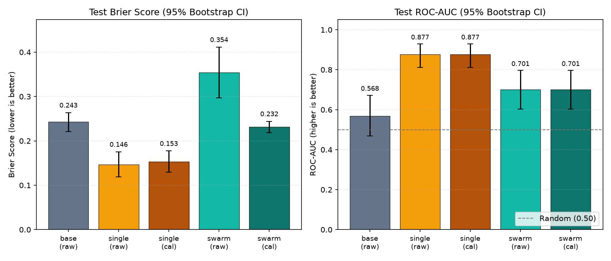
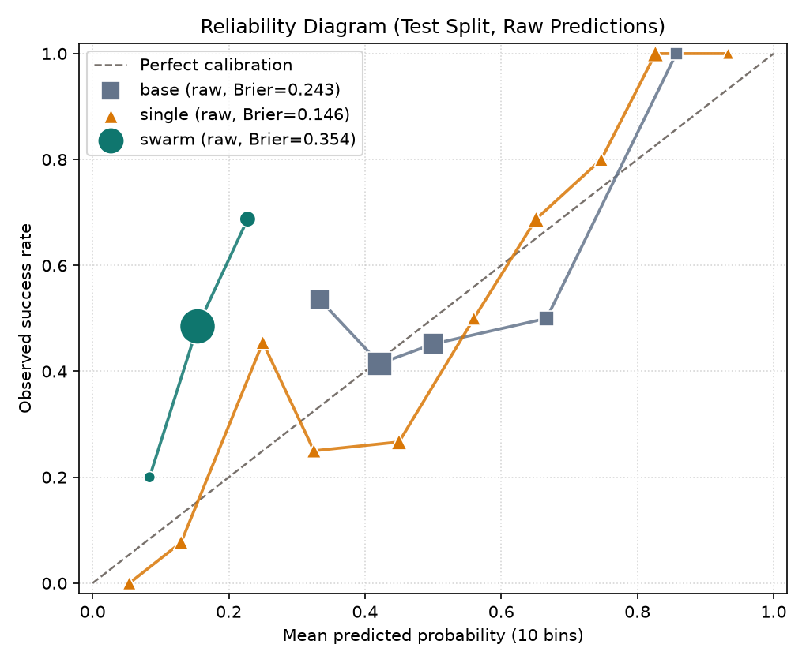

# Shadow Market

**A live pitch room with two AI assistants.** The founder pitches out loud. The judges' laptop listens, and a team of six AI specialists (market size, competitors, startup history, go-to-market, social, sales) researches the idea in real time with live Google Search, a 200-buyer Decisions API check and a backtested analyst, then suggests the sharpest questions to ask. When a judge asks *anything*, the founder's laptop shows a fact-checked answer in about 5 seconds and updates it with a live web search of that exact question. Behind it, the full pipeline can build the MVP, send browser agents through it, and fix it.

Built in one day at the **Gemini 4 NYC Hackathon** (Nov 21, 2026) by Naman ([@Namantyagi2727](https://github.com/Namantyagi2727)) and Arnab ([@arnabdas1999](https://github.com/arnabdas1999)).
Track: **Problem Statement 1 — 5 Sigma** (+ Managed Agents).

---

## Live pitch session (the main demo)

| | Judge's assistant (Laptop B, `/judge/<id>`) | Founder's assistant (Laptop A, `/founder/<id>`) |
|---|---|---|
| Listens to | the judges' mic | the founder's mic |
| Shows | live transcript; **the team channel**: Maya (market size, web), Theo (competitors, web), Iris (startups that failed/succeeded, web), Ravi (go-to-market), Zoe (social/virality), Marco (sales), each with a suggested cross-question; **3 questions worth asking** with evidence | **a live answer to every judge question** (VERIFIED / PARTIAL / PUSH BACK + a line to say + code-checked proof), then an "Updated with web check" version; pitch notes, research, prepared answers |

**Flow:** pitch → `gemini-3.5-transcribe-live` (each laptop's mic tags the speaker) → `gemini-4-hydrogen` extracts the pitch → in parallel: Shopify catalog competitors, Google Search (Hydrogen with the `google_search` tool), the backtested `gemini-4-neon` analyst, 200 buyers × 5 rubrics on `gemini-decision-1`, and the six specialists → `gemini-4-neon` writes the judge questions. Judge speech → Decisions gate (is this a real question?) → `gemini-3.5-flash-lite` answer card (1.7 s vs 8.2 s on Hydrogen for a 75-word answer) + Decisions badge → live web check of that question → updated card.

**Measured in live tests today (real voices, venue noise, two laptops on a phone hotspot):**

| Step | Measured |
|---|---|
| Pitch understood after the founder stops | ~5 s (the transcriber never closes sentences in a noisy room, so a caption unchanged for 2.5 s is committed; we found this in the live test) |
| Specialists' notes on the judge screen | 10–28 s after the pitch |
| First 3 judge questions | ~23 s; refreshed with web facts at ~43 s |
| Judge question → founder answer card | **~5 s** (gate 0.25–0.7 s) |
| Answer updated with a live web check | ~20–30 s later (e.g. found a New York competitor the founder hadn't mentioned) |
| Small talk / founder's own lines wrongly treated as questions | 0 in the live tests (gate 0.01–0.13 on small talk) |

## The full pipeline

## What it does

| # | Stage | What happens | Gemini |
|---|---|---|---|
| 1 | **Pitch** | Founder records a ~20 s webcam clip (voice + sketch) or types the idea. | `gemini-4-hydrogen` turns the video into a structured pitch |
| 2 | **Boardroom** | A strategist and a hostile skeptic argue out loud for 4 turns and agree a V1 spec. Real competing products are pulled from Shopify at the same time. | `gemini-4-neon` vs `gemini-4-argon`, voiced with `gemini-3.8-flash-tts`; Shopify catalog search (`mcp.shop.com`) |
| 3 | **Build** | A managed agent writes the MVP landing page + checkout inside a Google-hosted sandbox. | **Antigravity Managed Agent** (`antigravity-preview-09-2026`) |
| 4 | **Usability lab** | 6 distinct buyer personas open the MVP in headless Chromium, think aloud, click, and buy or quit. Every visit is recorded. | `gemini-4-hydrogen` drives each browser from screenshots |
| 5 | **Quit analysis** | Each quitter's recording is reviewed to timestamp the moment of confusion or exit. | `gemini-4-hydrogen` video understanding |
| 6 | **Market swarm** | 200 buyer personas × 5 rubrics (clarity, urgency, price fit, trust, beats competitors) = **1,000 calibrated probabilities in one call, ~3 s**. | **Decisions API** (`gemini-decision-1`) |
| 7 | **Verdict** | Launch probability from the backtested analyst; the swarm, lab and boardroom explain *why* and what to fix. | `gemini-4-neon` (number), `gemini-4-carbon` (explanation) |
| 8 | **Hot-seat** | Click a persona who quit and interview it by voice; it answers from its recorded clicks and thoughts. | **Gemini Live** (`gemini-3.8-live`) |
| 9 | **Live Q&A room** | A second laptop at the judges' table listens to the room. When a judge asks a real question, a judge twin voices a sharper version, and the founder's screen shows **VERIFIED / PARTIAL / PUSH BACK**, a line to say, and proof from this run. | `gemini-3.5-transcribe-live` → Decisions gate → **Gemini Live** twin → `gemini-4-hydrogen` + Decisions + a code number checker |
| 10 | **Reality check** | The room votes Buy / Bounce on an iPad; the live tally sits next to the AI's prediction. | — |

### Devices on stage
- **Laptop A** — main screen: the pipeline + the founder's teleprompter (and runs the backend).
- **Laptop B** — the judges' table: room mic, judge-twin seats with speech bubbles, twins speak out loud.
- **iPad** — Buy / Bounce vote and live tally.

---

## Proof it works

### 1. Backtest: can it predict which launches succeed?

**Data.** 150 real Kickstarter campaigns that **ended in 2026** (after the models' training data, so outcomes can't be memorized), from the public [Web Robots Kickstarter crawl](https://webrobots.io/kickstarter-datasets/) of 2026-11-16. USD only, deadline 2026-01-01 to 2026-11-15, stratified by category, **balanced 75 successful / 75 failed** (the crawl itself is 83% successful because failed campaigns drop out of listings; balancing stops "always say yes" from looking good). Split 30 calibration / 120 test, fixed seed.
Inputs: name, blurb, category, funding goal. **Never** pledged amount, backers, staff pick or anything after launch.
We commit only campaign IDs (`eval/sample_ids.json`) and the scripts, not the data.

**Results on the 120 test campaigns** (`eval/RESULTS.md`, 95% bootstrap CIs):

| Approach | ROC-AUC ↑ | Brier ↓ |
|---|---|---|
| Category base rate | 0.57 [0.47–0.67] | 0.243 |
| Funding goal alone | 0.71 | — |
| **Single `gemini-4-neon` analyst (text only)** | **0.88 [0.81–0.93]** | **0.146 [0.119–0.175]** |
| Our 200-persona Decisions swarm (calibrated) | 0.70 [0.60–0.80] | 0.232 |
| Analyst + swarm combined | 0.88 | 0.153 |




**What we changed because of it**
- **We caught a leak in our own first run.** With campaign photos included, the single model scored AUC 0.96. Reading its own explanations showed why: successful creators update their photo with banners like *"FUNDED IN 14 HOURS!"*. We removed images from every arm and kept the leaky run for the record (`eval/RESULTS_leaky_with_images.md`).
- **Our original thesis lost, so we changed the product.** We expected a buyer swarm to beat a single model. It didn't: the swarm measures *buyer appeal*, while funding depends more on goal size and audience, which the analyst reasons about. So the **verdict's number now comes from the analyst** (the same prompt and input format that was backtested — `backend/pipeline/analyst.py`), and the swarm, browser lab and boardroom are used to explain *why* and what to fix.
- The single model was **not** over-optimistic on this data (mean prediction 0.49 vs 0.50 actual), so we make no "LLMs are sycophantic" claim.

Reproduce: `uv run --project backend python eval/sample_dataset.py && uv run --project backend python eval/run_eval.py && uv run --project backend python eval/report.py`

### 2. Live Q&A room: measured, not promised

Measured end to end with spoken audio streamed into the room endpoint (`backend/spikes/test_room_e2e.py`, `test_room_live_twin.py`):

| Step | Measured |
|---|---|
| Decisions gate (is this a real challenge?) | **0.2–0.9 s** per utterance. Smoke test only (6 lines we wrote, not an evaluation): small talk and the founder's own statements scored 0.01–0.11, real challenges 0.92–0.99 |
| Gemini Live twin: challenge (tool call) after the gate | **~1.2 s**; first spoken audio ~1.8 s |
| Founder teleprompter card after the judge stops talking | **~6.6 s** (Live twin path) |
| Proof pills blocked by the number checker | live counter at `GET /api/room/stats` |

**Self-check:** every number shown on the founder's teleprompter is checked by code against this run's real data before it appears; pills that fail are dropped and replaced by a value taken directly from the evidence.

### 3. Browser lab vs screenshots (`eval/lab/LAB_RESULTS.md`)
5 model-generated MVP pages × 5 injected UX traps (hidden fee, dead buy button, tiny tap targets, hidden price, forced signup) + clean controls. **Panel 72% vs one Gemini call on static screenshots 80%; 96% if either finds it.** The panel catches interaction bugs screenshots can't (dead buttons 80% vs 20%) with 0% false alarms; screenshots catch visual ones the agents click past (tiny targets 100% vs 0%). Traps on trap pages cut panel conversions from 53% to 19%. Traps were injected by us into model-generated pages; grading is automatic (Decisions API, threshold 0.5).

### 4. Where it still breaks
- **Build time.** The managed-agent MVP build takes ~2.5–3 min, so a full run is 6–8 min. On stage we start the run before our slot and keep a fallback replay.
- **No speaker labels in live transcription** (diarization isn't supported in streaming mode). We separate judges from the founder by *what* is said, using the Decisions gate, and keep the room mic at the judges' end of the table.
- **Agentic video mode is slow** (95 s for a 14 s clip), so quit analysis uses standard video understanding plus the recorded action log.
- **Persona agents are more patient and literal than people** — some hit the 12-step limit instead of quitting; we report that as "ran out of patience".
- **The swarm doesn't predict funding** (AUC 0.70); we use it for diagnosis only.

---

## How it's built

```
frontend/   Next.js (App Router, TypeScript, Tailwind) — stage, judges' room, vote page, hot-seat Live client
backend/    Python 3.12, FastAPI + WebSockets, google-genai 3.6, Playwright
  pipeline/ pitch, boardroom, competitors, build, lab, quit_analysis, swarm, analyst, verdict, hotseat, room
  models.py the only place model IDs live (verified against models.list)
eval/       backtest scripts, results, charts
contracts/  events.md (pipeline events) and room.md (live Q&A room) — the only interface between frontend and backend
```

All Gemini calls are server-side. The browser only ever gets **single-use ephemeral tokens** for Gemini Live sessions, never the API key.

### Run it

Requirements: Python 3.12 + [uv](https://docs.astral.sh/uv/), Node 22+, a Gemini API key.

```bash
cp .env.example .env   # then put your GEMINI_API_KEY in .env (never commit it)
```
```bash
cd backend && uv sync && uv run playwright install chromium && uv run uvicorn app:app --host 0.0.0.0 --port 8000
```
```bash
cd frontend && npm ci && NEXT_PUBLIC_API_BASE=http://localhost:8000 npm run dev
```

Try a run without a webcam: `curl -X POST localhost:8000/api/runs -F 'text=A clip-on bike light that projects a lane onto the road, $39, for city commuters'`

---

## Built during the hackathon

Everything in this repository was written on Nov 21, 2026 during the event; see the commit history. No prior code was reused.

**Data credit:** Kickstarter campaign data from the [Web Robots](https://webrobots.io/kickstarter-datasets/) public crawl, used for evaluation only and not redistributed. Competitor products from Shopify's public catalog search.
