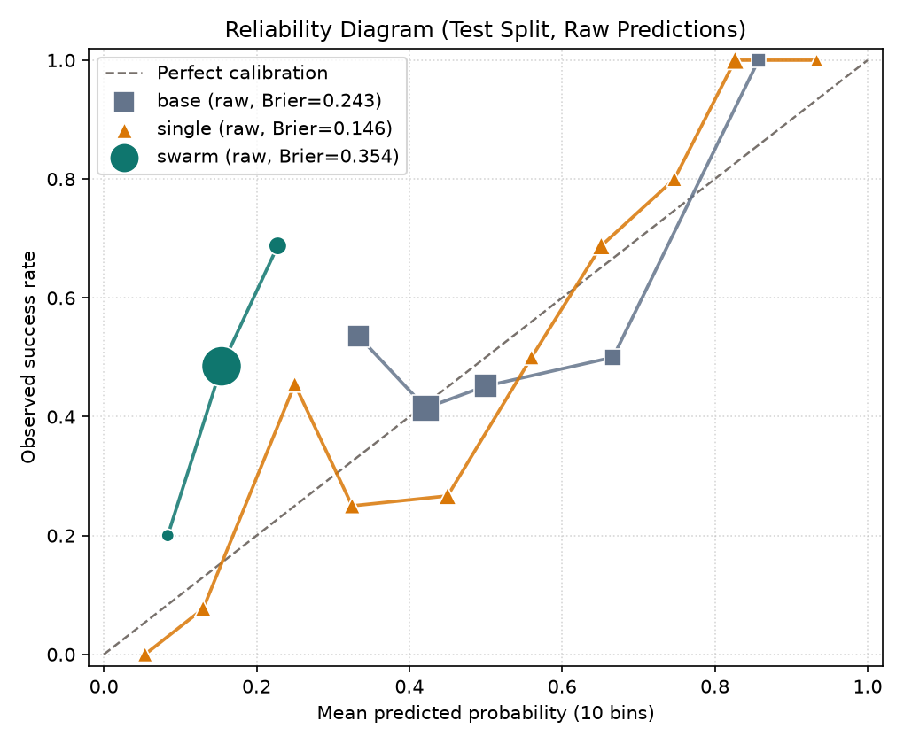
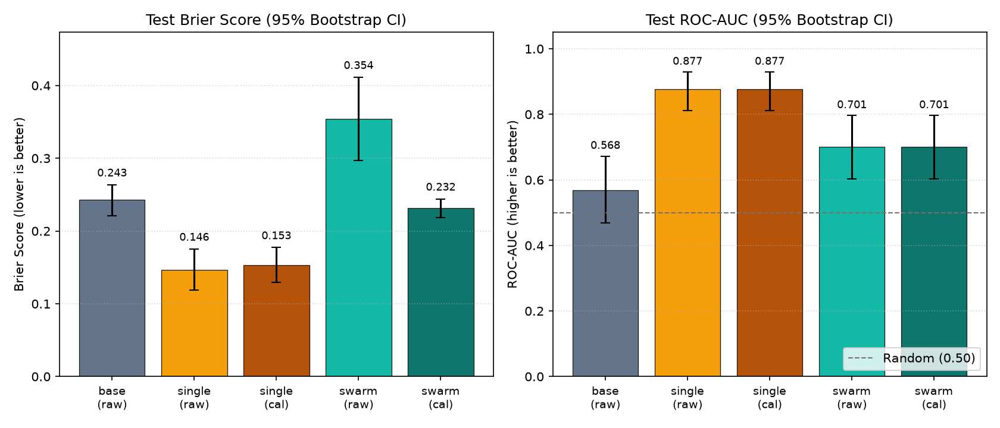

# 5-Sigma Backtest Results (2026 Kickstarter Launches)

- **Calibration split:** n=30 (actual success rate: 0.500)
- **Test split:** n=120 (actual success rate: 0.500)
- **Bootstrap:** 1,000 resamples (seed 0), 95% percentile CIs. Logistic calibration fit on `calib` only.

## Test Set Metrics

| Arm | Variant | N | Brier [95% CI] | ROC-AUC [95% CI] | Mean Pred | Actual Rate | Share > 0.5 |
|---|---|---:|---|---|---:|---:|---:|
| base | raw | 120 | 0.2428 [0.2210, 0.2636] | 0.5683 [0.4688, 0.6721] | 0.4748 | 0.5000 | 16.7% |
| single | raw | 120 | 0.1463 [0.1186, 0.1753] | 0.8775 [0.8121, 0.9289] | 0.4897 | 0.5000 | 49.2% |
| single | calibrated | 120 | 0.1530 [0.1294, 0.1773] | 0.8775 [0.8121, 0.9289] | 0.4814 | 0.5000 | 49.2% |
| swarm | raw | 120 | 0.3544 [0.2968, 0.4113] | 0.7011 [0.6035, 0.7961] | 0.1610 | 0.5000 | 0.0% |
| swarm | calibrated | 120 | 0.2317 [0.2182, 0.2441] | 0.7011 [0.6035, 0.7961] | 0.4915 | 0.5000 | 47.5% |

## Reading

On the test split, **single (calibrated)** achieves the lowest Brier score at 0.1530, beating runner-up **swarm (calibrated)** (0.2317) by 0.0787; on discrimination, **single (calibrated)** leads with ROC-AUC 0.8775 (+0.1764 over swarm at 0.7011). Statistical uncertainty: Brier 95% CIs between single (0.129–0.177) and swarm (0.218–0.244) do not overlap; and AUC 95% CIs between single (0.812–0.929) and swarm (0.604–0.796) do not overlap. Against the 0.500 actual test success rate, single raw mean=0.490 (bias -0.010, 49% > 0.5) -> calibrated Brier 0.1530 (+0.0067); swarm raw mean=0.161 (bias -0.339, 0% > 0.5) -> calibrated Brier 0.2317 (-0.1227).

## Charts

## Top 5 Most Confidently Wrong Swarm Campaigns (Test Split)

| ID | Name | Swarm p (raw) | Swarm p (cal) | Label | |p - label| |
|---|---|---:|---:|---:|---:|
| 506656976 | AUTUMN STAY : HUNTED | 0.0922 | 0.3401 | 1 | 0.9078 |
| 1632833710 | lamp: the feature film | 0.1015 | 0.3650 | 1 | 0.8985 |
| 510838538 | Sonatas of the Nations | 0.1098 | 0.3864 | 1 | 0.8902 |
| 10320872 | pocket soda | 0.1117 | 0.3913 | 1 | 0.8883 |
| 549470769 | Celestial Pirouette: A Sci-Fi Dance Short | 0.1128 | 0.3940 | 1 | 0.8872 |
