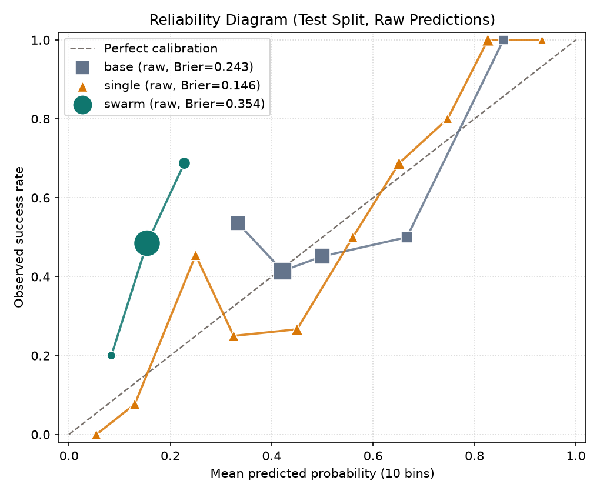
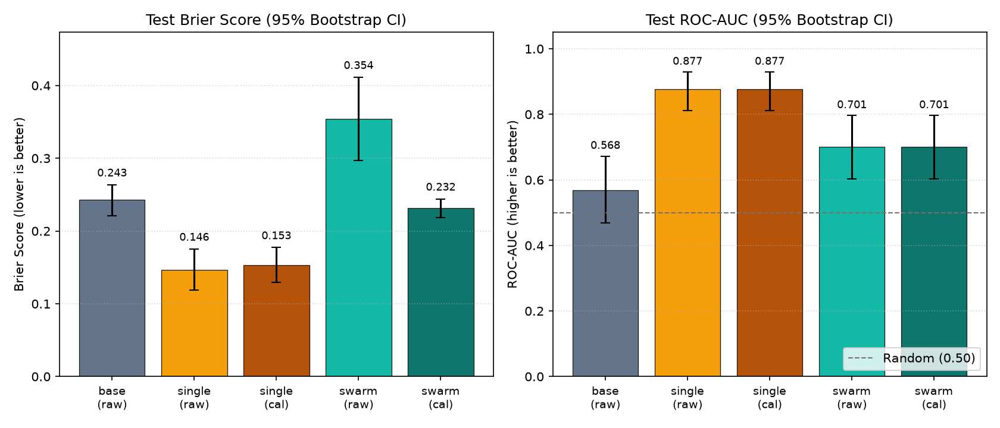

# 5-Sigma Backtest Results (2026 Kickstarter Launches)

- **Calibration split:** n=30 (actual success rate: 0.500)
- **Test split:** n=120 (actual success rate: 0.500)
- **Bootstrap:** 1,000 resamples (seed 0), 95% percentile CIs. Logistic calibration fit on `calib` only.

## Test Set Metrics

| Arm | Variant | N | Brier [95% CI] | ROC-AUC [95% CI] | Mean Pred | Actual Rate | Share > 0.5 |
|---|---|---:|---|---|---:|---:|---:|
| base | raw | 120 | 0.2428 [0.2210, 0.2636] | 0.5683 [0.4688, 0.6721] | 0.4748 | 0.5000 | 16.7% |
| single | raw | 120 | 0.0928 [0.0700, 0.1195] | 0.9590 [0.9240, 0.9852] | 0.5259 | 0.5000 | 55.0% |
| single | calibrated | 120 | 0.1012 [0.0804, 0.1239] | 0.9590 [0.9240, 0.9852] | 0.5118 | 0.5000 | 52.5% |
| swarm | raw | 120 | 0.3241 [0.2746, 0.3718] | 0.6928 [0.5910, 0.7854] | 0.2105 | 0.5000 | 0.0% |
| swarm | calibrated | 120 | 0.2413 [0.2358, 0.2471] | 0.6928 [0.5910, 0.7854] | 0.4960 | 0.5000 | 45.8% |

## Reading

On the test split, **single (calibrated)** achieves the lowest Brier score at 0.1012, beating runner-up **swarm (calibrated)** (0.2413) by 0.1401; on discrimination, **single (calibrated)** leads with ROC-AUC 0.9590 (+0.2662 over swarm at 0.6928). Statistical uncertainty: Brier 95% CIs between single (0.080–0.124) and swarm (0.236–0.247) do not overlap; and AUC 95% CIs between single (0.924–0.985) and swarm (0.591–0.785) do not overlap. Against the 0.500 actual test success rate, single raw mean=0.526 (bias +0.026, 55% > 0.5) -> calibrated Brier 0.1012 (+0.0084); swarm raw mean=0.210 (bias -0.289, 0% > 0.5) -> calibrated Brier 0.2413 (-0.0828).

## Charts

## Top 5 Most Confidently Wrong Swarm Campaigns (Test Split)

| ID | Name | Swarm p (raw) | Swarm p (cal) | Label | |p - label| |
|---|---|---:|---:|---:|---:|
| 1632833710 | lamp: the feature film | 0.1298 | 0.4177 | 1 | 0.8702 |
| 10320872 | pocket soda | 0.1400 | 0.4296 | 1 | 0.8600 |
| 506656976 | AUTUMN STAY : HUNTED | 0.1694 | 0.4608 | 1 | 0.8306 |
| 549470769 | Celestial Pirouette: A Sci-Fi Dance Short | 0.1719 | 0.4632 | 1 | 0.8281 |
| 1095072196 | Sociopath - A dark otome reverse mysteries visual novel RPG | 0.1725 | 0.4638 | 1 | 0.8275 |
